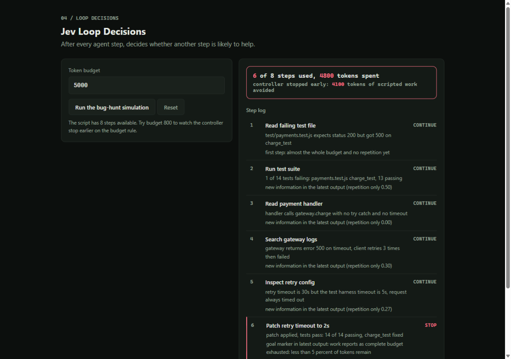

# Jev Loop Decisions

[](https://nodejs.org)
[](#)
[](#)

After every agent step, Jev judges the trajectory and predicts whether another
step is likely to help: CONTINUE or STOP. A scripted bug-hunt runs under the
controller so you can watch it stop at the fix and see the tokens saved.



## What it does

Run the simulation and the step log fills in order, one row per step, each with
the controller verdict and its reason. The stop row gets the coral highlight.
The summary strip reports steps used of available, tokens spent, and tokens of
scripted work the early stop avoided. Lower the budget and the same script
stops earlier on the budget rule. Reset clears everything; the run ledger
keeps the last 8 runs.

## The stop rules

Five signals feed the controller, evaluated after each step:

| Signal | Stops when |
|---|---|
| goal marker | latest output reports completion: tests pass, patch applied, fixed |
| repetition | 60%+ of the latest output's words already appeared earlier |
| error streak | three consecutive failing steps with no new information |
| budget | under 5% of the token budget remains |
| first step | never stops on step one |

The scenario is deterministic: 8 scripted steps of a bug hunt, where the fix
lands at step 6. With the default 5000-token budget the controller stops there
and 4100 tokens of follow-on work are avoided; with a 700 budget it stops at
step 3. The controller is in `lib/score.js`.

## Quick start

```bash
node server.js
# open http://localhost:3914
```

Node 18 or newer. No install, no keys.

## Tests

```bash
node test.js
```

Nine test groups: fresh continue, goal stop, repetition stop, budget stop,
streak with no progress, failing outputs that still add facts, simulation
saving tokens, tighter budget stopping sooner, and determinism.

## API

```
POST /api/evaluate   { steps: [..], budget }   one verdict for the trajectory
POST /api/simulate   { budget }                walk the scripted scenario
GET  /api/health                               { ok: true }
```

## Docs

Full framework in this repo: [prd.md](prd.md), [trd.md](trd.md),
[architecture.md](architecture.md), [design.md](design.md),
[schema.md](schema.md), [implementation.md](implementation.md),
[rules.md](rules.md).

## Part of the Jev Control Plane

Five demos, one small-model layer that sits in front of an AI agent:

- [Model-Router](https://github.com/trytotest13/Model-Router): which model answers
- [Tool-Risk-Gate](https://github.com/trytotest13/Tool-Risk-Gate): allow, review, or block a tool call
- [Intent-Triage](https://github.com/trytotest13/Intent-Triage): classify a ticket before the agent reasons
- [Loop-Decisions](https://github.com/trytotest13/Loop-Decisions): continue or stop the agent loop
- [RAG-Reranker](https://github.com/trytotest13/RAG-Reranker): rerank retrieved chunks
